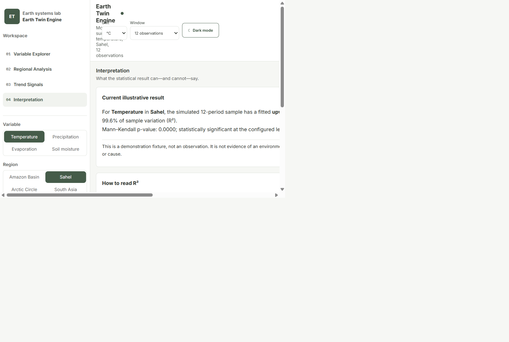

# Earth Twin Engine — Frontend

Responsive React + TypeScript exploration interface for the Earth Twin Engine project.

> **Data integrity notice:** the current scientific series are explicitly simulated UI fixtures. They are not NASA observations and must not be used to support scientific conclusions.

The workspace includes light and dark themes. On first load it uses the operating-system theme unless a saved choice exists; explicit selections are remembered in browser storage.

Typography uses Inter for the interface and IBM Plex Mono for numeric/data labels.

## Run locally

Requires Python 3.12–3.15, Node.js 24, and npm. Run the backend and frontend in separate terminals.

```powershell
# From the repository root (first run only)
.\.venv\Scripts\python.exe -m pip install -e ".[api,dev]"
.\.venv\Scripts\python.exe -m uvicorn earth_twin_engine.api:app --app-dir src --reload --host 127.0.0.1 --port 8000
```

```powershell
# In a second terminal
cd frontend
Copy-Item .env.example .env
npm ci
npm run dev
```

The development server is available at `http://localhost:5173`. The backend health check is at
`http://localhost:8000/api/v1/health`; interactive API docs are at `http://localhost:8000/docs`.

## Quality checks

```powershell
npm run lint
npm test
npm run build
npm run format:check
```

The production build is written to `dist/`.

## Architecture

- `src/App.tsx` provides lazy-loaded routes, the fixed-sidebar workspace shell, compact controls, scenario progress, and provenance footer.
- `src/context/ExplorerContext.tsx` owns variable, region, unit, date-window, backend-analysis, and scenario state.
- `src/api/trends.ts` sends fixture observations to the Python API and types its statistical results.
- `src/data/earthData.ts` contains the clearly labeled simulated fixture and least-squares trend diagnostics.
- `src/components/TrendChart.tsx` renders observed values, the fitted line, and a descriptive residual envelope with Recharts.
- `src/components/RegionMap.tsx` shows the selected approximate region with React Leaflet.
- `src/pages/` contains the variable explorer, region locator, trend comparisons, and interpretation pages.
- `src/components/ui.tsx` contains shared card, KPI, segmented-control, loading, empty, error, and info-tip components.

The API uses the existing Python `TrendAnalyzer` (linear regression, Sen’s slope, and Mann–Kendall); it is a statistical model, not trained AI/ML. The trend label uses the analyzer’s significance test. R² is a descriptive linear-fit measure, **not** confidence. The chart’s shaded residual envelope is descriptive, not a confidence interval.

## Data sources and attribution

| Source                          | Use in this preview                                                                                       | Attribution                                                        |
| ------------------------------- | --------------------------------------------------------------------------------------------------------- | ------------------------------------------------------------------ |
| Local Earth Twin Engine fixture | Simulated temperature, precipitation, evaporation, and soil-moisture examples sent to the local trend API | Authored as synthetic interface data; no NASA dataset is connected |
| OpenStreetMap                   | Grayscale geographic locator tiles                                                                        | © OpenStreetMap contributors                                       |

NASA Space Apps is the challenge context, not the source of the preview's measurements. A real provider adapter and NASA dataset citation must be added before presenting this interface as an observational analysis. The API only analyzes the fixture values; it does not fetch NASA data.

## Screenshots

### Desktop explorer



The interface also collapses to a single-column mobile layout with a drawer navigation menu.

## Deployment

- **Docker:** `docker build -t earth-twin-engine-frontend .` then `docker run --rm -p 8080:80 earth-twin-engine-frontend`.
- **Vercel:** import the `frontend/` directory; `vercel.json` configures the Vite build and SPA fallback.
- **Netlify:** set the base directory to `frontend/`; `netlify.toml` configures build, publish, and route fallback.

Set `VITE_API_BASE_URL` to the backend origin when deploying the frontend. Configure backend CORS with
`ETE_CORS_ORIGINS` as a comma-separated list of trusted frontend origins; the local Vite origin is
allowed by default.
